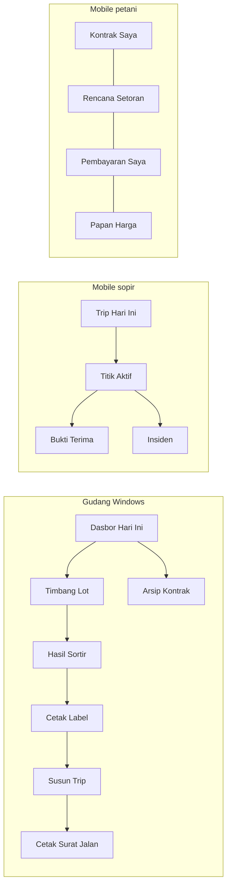

> Versi: v1.0.0 | Status: disetujui | Menggantikan: -
> Sumber: Lumbung-TownHall `platform/versions/v1.0.0/` pada commit `673a467` ([platform/versions/v1.0.0](https://github.com/Coding-Skuy/Lumbung-TownHall/blob/673a467126e195ffd67c9d3ff21d108193a6c3ec/platform/versions/v1.0.0))

# 40 — Tech Stack lumbung-app-kmp

Matriks stack, fitur per platform, dan navigation graph ringkas. Versi dari `gradle/libs.versions.toml`.

## Matriks stack

| Komponen | Versi | Catatan |
|---|---|---|
| Kotlin | 2.2.20 | pin exact |
| Compose Multiplatform | 1.8.2 | UI bersama |
| Navigation3 | 1.0.0 | `sealed interface Route` di `core.nav` |
| Ktor Client | 3.1.3 | OkHttp (Android), Darwin (iOS), WinHttp (Windows) |
| SQLDelight | 2.1.0 | driver android/native/jvm |
| kotlinx-coroutines | 1.10.1 | |
| AGP | 8.7.2 | build Android |
| JDK | 17 | prasyarat build |

## Matriks fitur per platform

| Fitur | Windows (gudang) | Android | iOS |
|---|---|---|---|
| Dasbor Hari Ini + bilah Online/Offline + antrean | ya | tidak | tidak |
| Timbang ganda KOTOR/BERSIH (USB/serial) | ya | tidak | tidak |
| Hasil Sortir A/B/C (toleransi 2%) | ya | tidak | tidak |
| Cetak Label keranjang + surat jalan (thermal 80 mm) | ya | tidak | tidak |
| Susun Trip + Arsip Kontrak | ya | tidak | tidak |
| Login shift PIN operator (token 12 jam) | ya | tidak | tidak |
| Sopir: Trip Hari Ini, Titik Aktif, Bukti Terima (foto maks 500 KB, 4 foto), Insiden | tidak | ya | ya |
| Petani: Kontrak Saya, Rencana Setoran, Pembayaran Saya, Papan Harga | tidak | ya | ya |
| Offline-first + outbox FIFO | ya | ya | ya |
| GPS tiap 5 menit selama trip aktif | tidak | ya | ya |

## Navigation graph ringkas

## Distribusi

Windows x64 MSIX 1.0.0 (tanpa auto-update); Android Play Store + APK sideload; iOS TestFlight/IPA. Pipeline di `lumbung-infra-devops`.
